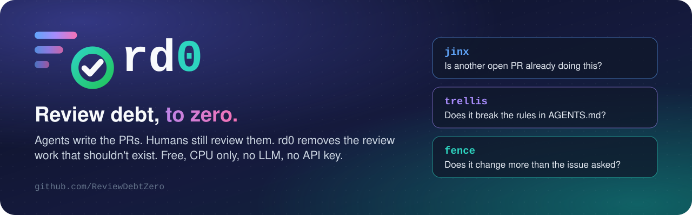

  

**Coding agents made writing a pull request nearly free. Reviewing one is still human time.**
rd0 is a set of small, free checks that remove the review work that shouldn't exist. Each runs on CPU, needs
no LLM or API key, and leaves one comment with its reasons before a reviewer opens the diff.

| Tool | Question it answers | Get it |
|---|---|---|
| [**Jinx**](https://github.com/ReviewDebtZero/rd0-jinx) | Is another open PR already doing this? | `pip install rd0-jinx` · [site](https://rd0-jinx.netlify.app) |
| [**Trellis**](https://github.com/ReviewDebtZero/rd0-trellis) | Does it break the rules written in AGENTS.md? | `pip install rd0-trellis` |
| [**Fence**](https://github.com/ReviewDebtZero/rd0-fence) | Does it change more than the issue asked for? | early; PyPI release pending |
| [**rd0 skill**](https://github.com/ReviewDebtZero/rd0) | Can the agent run all three on itself first? | Claude Code skill + AGENTS.md snippet |

**Why it matters**, from public data ([AIDev](https://huggingface.co/datasets/hao-li/AIDev), CC BY 4.0):
- In about 1 in 5 cross-author duplicate agent PRs, a human had already reviewed the duplicate.
- Unintended side effects (22.3%) and overengineering (22.1%) cause more agent-PR reverts than functional bugs (17.7%) (MSR 2026, 33,580 PRs).

**What we don't claim yet:** reviewer time saved (no deployment study), and human-validated precision for
Fence and Trellis. Every number links to a committed result file in its tool's repo.

Research: each tool comes with a reproducible benchmark on an existing public dataset and a short paper.
MIT licensed.
